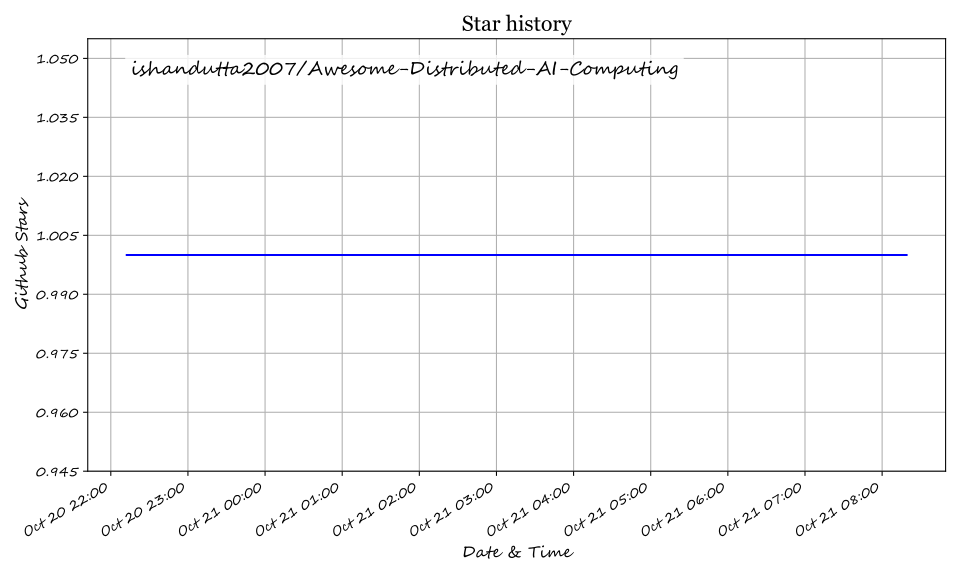

# Awesome Distributed AI Computing

  

  
  
  
  
  
  

  <strong>Curated ecosystem of SaaS platforms and open-source frameworks for distributed machine learning training, LLM orchestration, high-throughput model serving, and cluster compute fabrics.</strong>

---

## 🧭 Table of Contents

- [🌐 Sector Overview & Market Dynamics](#-sector-overview--market-dynamics)
- [🏢 SaaS & Hosted Cloud Platforms](#-saas--hosted-cloud-platforms)
- [⚡ Open-Source GitHub Frameworks](#-open-source-github-frameworks)
- [🏗️ Architectural Ecosystem Matrix](#️-architectural-ecosystem-matrix)
- [🤝 How to Contribute](#-how-to-contribute)
- [💖 Support & Sponsorship](#-support--sponsorship)
- [⭐ Star History](#-star-history)
- [📜 Disclaimer](#-disclaimer)

---

## 🌐 Sector Overview & Market Dynamics

The global distributed AI computing and AI infrastructure market is estimated at approximately **$260B–$390B in 2025–2026**, projected to grow beyond **$800B+ by the early 2030s** driven by hyperscale cluster expansions, foundation model pre-training, and multi-node inference fabrics. The sector displays a **moderately fragmented yet top-heavy concentration dynamic**: hyperscalers and mega-cap platform leaders (Databricks, Snowflake, NVIDIA) dominate core cloud data lakehouses and GPU orchestration layers, while specialized Ray orchestration, distributed MLOps, and task execution tiers maintain active fragmentation driven by rapid open-source innovation.

---

## 🏢 SaaS & Hosted Cloud Platforms

A comprehensive comparison of top commercial platforms powering enterprise distributed training, high-performance data lakehouses, and GPU cluster orchestration, sorted in descending order by company valuation/revenue scale:

| Platform | Description | Company Size (Valuation / Revenue) | Pricing | Free Tier / Trial Limits |
| :--- | :--- | :--- | :--- | :--- |
| **Databricks** | Lakehouse platform providing managed Spark, Delta Lake, and MLflow with Unity Catalog governance. | **$190B valuation** (Aug 2026 funding round) / **>$7B revenue run-rate** (80%+ YoY) | Starts at **$0.15/DBU** (Jobs Classic) to **$0.55/DBU** (All-Purpose Classic); Serverless from **$0.35–$0.75/DBU** | **14-day free trial** with up to **$400 in usage credits** (plus fair-use Free Community Edition) |
| **Snowflake** | Cloud data warehouse & AI/ML platform with Snowpark, Cortex AI, and Apache Iceberg support. | **~$110B market cap** / **$4.47B revenue** (FY2026, 35% YoY) | Starts at **$2.00/credit** (Standard Edition) or **$3.00/credit** (Enterprise Edition) | **30-day free trial** with **$400 in free usage credits** (no credit card required) |
| **Cloudera** | Enterprise data platform with hybrid lakehouse, distributed analytics, and AI capabilities. | **~$5.3B valuation** (CD&R / KKR private buyout) / **50%+ YoY growth** in new/expansion ARR | Starts at **$0.07/CCU-hr** (Data Warehouse), **$0.15/CCU-hr** (Data Engineering), **$0.20/CCU-hr** (Machine Learning) | **60-day free trial** for CDP Public Cloud / CDP Private Cloud Base evaluation |
| **Anyscale** | Managed Ray platform enabling scaling AI workloads & distributed training from laptops to clusters. | **$1.65B acquisition valuation** (acquired by Nscale, July 2026) / **$1.38B Series C** | Starts at **$1.00/Anyscale Credit (AC)** (standard node compute); GPU node instances from ~$4.95/hr | **Free tier account** with **$100 in starting credits** to run distributed Ray jobs |
| **Domino Data Lab** | Enterprise MLOps platform for collaborative distributed model development, training, and governance. | **~$916M valuation** (Series F, August 2025) | Starts at **~$150–$250/user/month** for practitioner seats (plus base platform fee); enterprise custom quotes | **14-day evaluation trial** via dedicated hands-on evaluation environments (e.g., NVIDIA LaunchPad) |
| **Run:ai (NVIDIA)** | GPU orchestration and virtualization platform for distributed AI workloads on Kubernetes. | **~$700M acquisition valuation** (acquired by NVIDIA, Dec 2024; backed by **NVIDIA's $3T+ market cap**) | Core orchestration is **$0 (Open Source via GitHub)**; commercial enterprise tier starts at **$4,500/GPU/year** | **Free forever open-source core** (KAI scheduler & GPU fractioning operator without node limits) |

---

## ⚡ Open-Source GitHub Frameworks

The leading open-source frameworks, distributed engines, and orchestration tools for scaling deep learning, LLMs, and Python workloads across clusters. Repositories are strictly sorted in descending order of GitHub stargazers:

- **[vLLM](https://github.com/vllm-project/vllm)**   
  **High-throughput and memory-efficient LLM serving engine** (Apache-2.0). Utilizes **PagedAttention** for near-optimal KV cache memory management, continuous batching, and tensor/pipeline parallel distributed inference across multi-GPU/multi-node clusters.  
  *Best for*: Production distributed LLM inference and serving with state-of-the-art token throughput.

- **[Apache Airflow](https://github.com/apache/airflow)**   
  **Platform to programmatically author, schedule, and monitor workflows** (Apache-2.0) — **the global standard for DAG-based orchestrations**. Integrates natively with Celery, Kubernetes, and cloud compute executors to coordinate heterogeneous distributed machine learning pipelines.  
  *Best for*: Batch data pipelines, scheduled model retraining jobs, and enterprise orchestration DAGs.

- **[Apache Spark](https://github.com/apache/spark)**   
  **Unified analytics engine for large-scale data processing** (Apache-2.0) — **the distributed batch processing standard**. Delivers in-memory computing across petabyte-scale datasets with **Spark SQL**, **Spark Streaming**, **MLlib**, and Python bindings (PySpark).  
  *Best for*: Petabyte-scale distributed ETL, feature engineering, and big-data pipelines before training.

- **[Ray](https://github.com/ray-project/ray)**   
  **Unified framework for scaling AI and Python applications** (Apache-2.0) — **the modern distributed AI compute standard**. Features **Ray Train** (multi-node distributed training), **Ray Serve** (scalable model serving), **Ray Tune** (distributed hyperparameter optimization), and **Ray Data** (distributed streaming data).  
  *Best for*: Scaling arbitrary Python code, distributed reinforcement learning, and heterogeneous GPU/TPU cluster workloads.

- **[DeepSpeed](https://github.com/deepspeedai/DeepSpeed)**   
  **Deep learning optimization library that makes distributed training efficient and easy** (Apache-2.0). Pioneered **ZeRO (Zero Redundancy Optimizer)** memory optimization, 3D parallelism (data, pipeline, tensor), and ZeRO-Offload to train models with hundreds of billions of parameters on limited GPU clusters.  
  *Best for*: Pre-training and fine-tuning massive LLMs and transformers with extreme memory efficiency.

- **[Colossal-AI](https://github.com/hpcaitech/ColossalAI)**   
  **Unified deep learning system for large-scale parallel AI models** (Apache-2.0). Provides complete multi-dimensional parallel execution (tensor, sequence, pipeline, and ZeRO-3) along with heterogeneous memory management to scale large language models efficiently.  
  *Best for*: Cost-effective training and fine-tuning of multi-billion parameter foundation models.

- **[MLflow](https://github.com/mlflow/mlflow)**   
  **Open-source machine learning lifecycle and AI engineering platform** (Apache-2.0) — **the experiment tracking standard**. Delivers centralized tracking, reproducible packaging, model evaluation, and deployment registries across distributed compute environments.  
  *Best for*: Tracking experiments, artifacts, and metrics across distributed training clusters.

- **[Prefect](https://github.com/PrefectHQ/prefect)**   
  **Modern workflow orchestration framework designed for Python developers** (Apache-2.0). Converts native Python code into dynamic, distributed workflows with automatic retries, instant scheduling, state transitions, and first-class async concurrency.  
  *Best for*: Resilient data and ML pipelines demanding high velocity and dynamic execution flows.

- **[DVC (Data Version Control)](https://github.com/iterative/dvc)**   
  **Data and model version control system for machine learning projects** (Apache-2.0). Tracks gigabyte-to-terabyte datasets, model weights, and pipeline lineage alongside Git without bloating repository history.  
  *Best for*: Reproducible machine learning experiments and datasets synchronized with distributed object storage.

- **[Kubeflow](https://github.com/kubeflow/kubeflow)**   
  **The Cloud Native Machine Learning Platform for Kubernetes** (Apache-2.0). Provides the **Training Operator** (Kubernetes-native distributed training for PyTorch, TensorFlow, and XGBoost), **Kubeflow Pipelines (KFP)**, and **Katib** for distributed hyperparameter tuning.  
  *Best for*: Cloud-native engineering teams orchestrating end-to-end ML workflows directly on Kubernetes clusters.

- **[Horovod](https://github.com/horovod/horovod)**   
  **Distributed deep learning training framework for TensorFlow, Keras, PyTorch, and Apache MXNet** (Apache-2.0). Uses ring-allreduce communication primitives via NCCL/MPI to make distributed data-parallel training fast with minimal code changes.  
  *Best for*: Scaling legacy and existing PyTorch or TensorFlow single-GPU code across multi-node clusters.

- **[Dask](https://github.com/dask/dask)**   
  **Flexible library for parallel and distributed computing in Python** (BSD-3-Clause) — **the NumPy/Pandas-native scaling choice**. Composed of dynamic task scheduling and big-data collections like `dask.array` and `dask.dataframe`.  
  *Best for*: Workflows that outgrow a single machine while maintaining native Python and Pandas syntax.

- **[SkyPilot](https://github.com/skypilot-org/skypilot)**   
  **Intercloud framework for running AI and batch jobs on any cloud** (Apache-2.0). Automatically provisions distributed compute, spots availability for lower-cost GPUs (AWS, GCP, Azure, Lambda, RunPod, OCI), and migrates jobs seamlessly.  
  *Best for*: Multi-cloud GPU cluster orchestration, spot instance cost optimization, and automatic multi-node cluster provisioning.

- **[Hugging Face Accelerate](https://github.com/huggingface/accelerate)**   
  **PyTorch scaling abstraction library** (Apache-2.0). Enables pure PyTorch code to run across Multi-GPU, Multi-Node, DeepSpeed, and FSDP (Fully Sharded Data Parallel) setups with zero boilerplate modifications.  
  *Best for*: Seamless scaling from local workstations to massive multi-node training clusters.

- **[FairScale](https://github.com/facebookresearch/fairscale)**   
  **PyTorch extension library for high-performance and large-scale distributed training** (BSD-3-Clause) developed by Meta AI. Offers pioneering implementations of FullyShardedDataParallel (FSDP), pipe parallelism, and gradient accumulation.  
  *Best for*: Research institutions and engineers requiring composable distributed primitives in PyTorch.

---

## 🏗️ Architectural Ecosystem Matrix

| Distributed Need | Category Leader | Python-Native Alternative | Kubernetes-Native Stack |
| :--- | :--- | :--- | :--- |
| **Large-Scale Data Processing / ETL** | Apache Spark | Dask (`dask.dataframe`) | Spark on Kubernetes / Ray Data |
| **Distributed AI Model Training** | Ray Train | Hugging Face Accelerate / Colossal-AI | Kubeflow Training Operator |
| **Large Language Model (LLM) Optimization** | DeepSpeed | Colossal-AI / FairScale | DeepSpeed Operator on K8s |
| **High-Throughput Model Serving** | vLLM | Ray Serve | KServe / vLLM on K8s |
| **Workflow & Pipeline Orchestration** | Apache Airflow | Prefect | Kubeflow Pipelines (KFP) |
| **Intercloud Compute & GPU Brokering** | SkyPilot | Ray Cluster Launcher | Run:ai Scheduler (NVIDIA) |

---

## 🤝 How to Contribute

Contributions are welcome and highly appreciated! To contribute new projects or updates:

1. 🍴 **Fork** this repository.
2. 🌿 Create a feature branch (`git checkout -b feature/new-distributed-tool`).
3. 📝 Add or update the project entry in `README.md` keeping alphabetical order or star rank intact.
4. 🌟 Ensure the Stars_Badge format matches ``.
5. 🚀 Submit a pull request with a concise overview of the tool.

---

## 💖 Support & Sponsorship

If you find this curated resource helpful for your distributed systems research, data engineering, or AI infrastructure projects, please consider supporting the project:

- ⭐ **Star this repository** on GitHub to help others discover it.
- 🔀 **Fork and share** it with your fellow engineers, colleagues, and AI researchers.
- ☕ **Sponsor the Maintainer**: [Buy a coffee and support future open-source tools on GitHub Sponsors](https://github.com/sponsors/ishandutta2007)!

  

---

## ⭐ Star History

---

## 📜 Disclaimer

- This is a **community-curated index** — not exhaustive and not a commercial endorsement.
- Distributed AI platforms handling enterprise data must comply with international data regulations (GDPR, HIPAA, CCPA) and enforce rigorous tenant isolation and encryption standards.
- **Managed Platform vs. Open Framework**: Managed platforms like Databricks and Snowflake offer turn-key onboarding but variable usage costs; open frameworks like Ray, Spark, and DeepSpeed offer total infrastructure autonomy at the expense of operational complexity.
- **Ray vs. Spark vs. Dask**: Ray excels at actor-based dynamic distributed Python execution, LLM training, and serving; Spark excels at massive batch ETL and structured query processing; Dask delivers seamless scaling for Python data science (NumPy, Pandas, Scikit-learn).

## ⭐ Star History

<a href="https://star-history.com/#ishandutta2007/Awesome-Distributed-AI-Computing&Timeline" align="center">
  <picture>
    <source media="(prefers-color-scheme: dark)" srcset="assets/ishandutta2007_Awesome-Distributed-AI-Computing_growth.svg">
    
  </picture>
</a>
